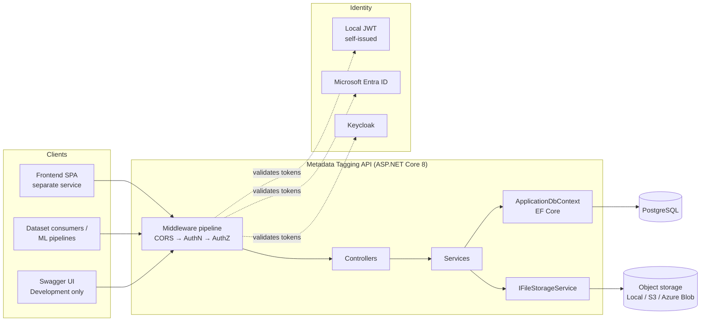
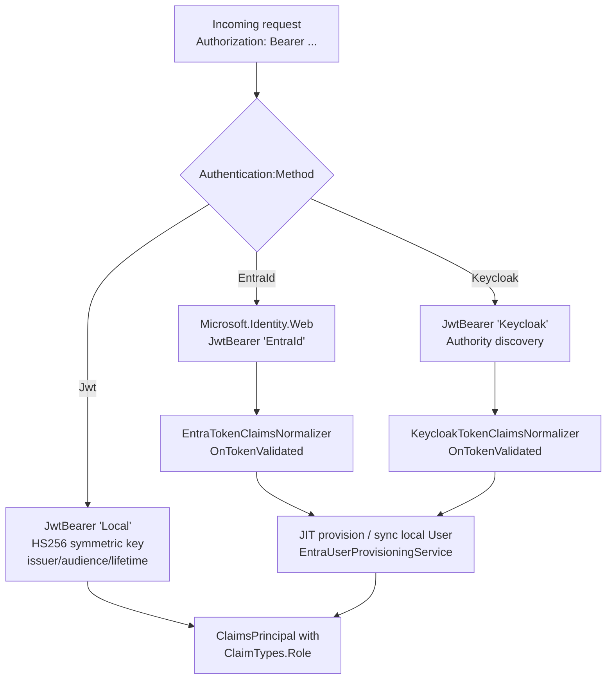
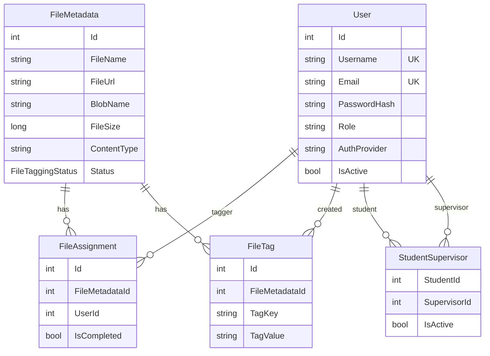
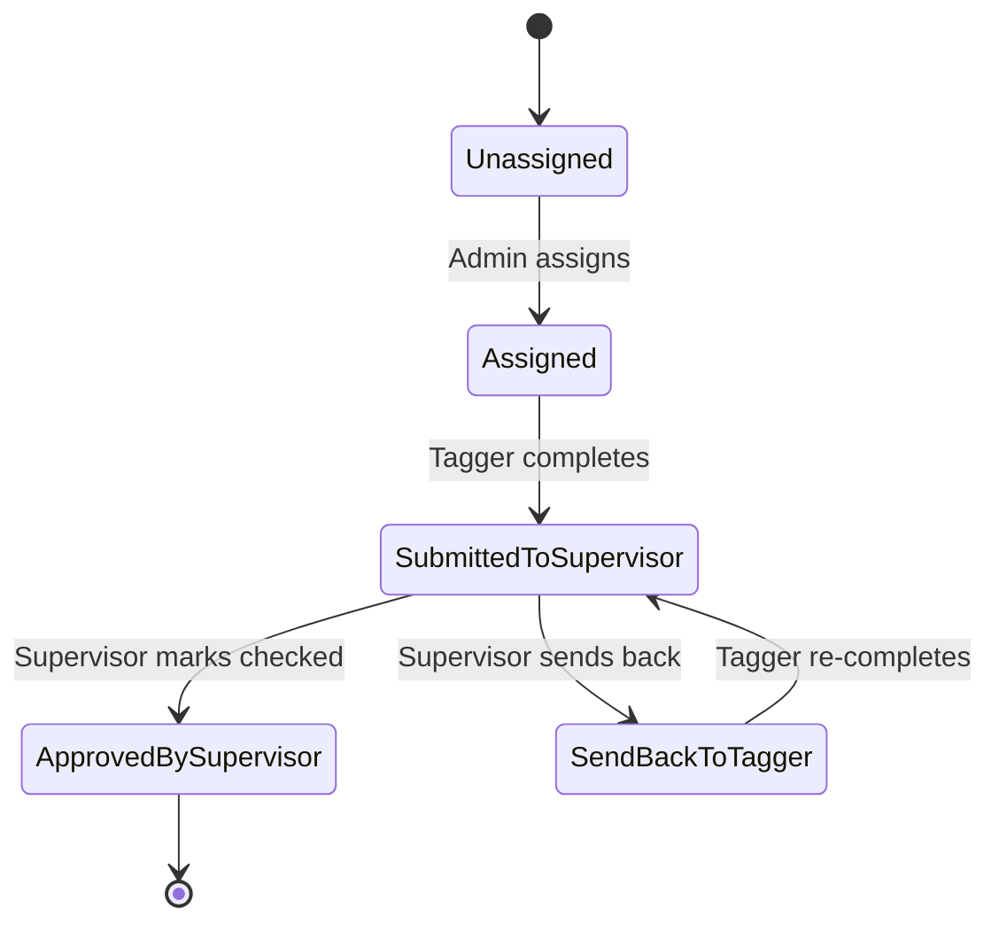
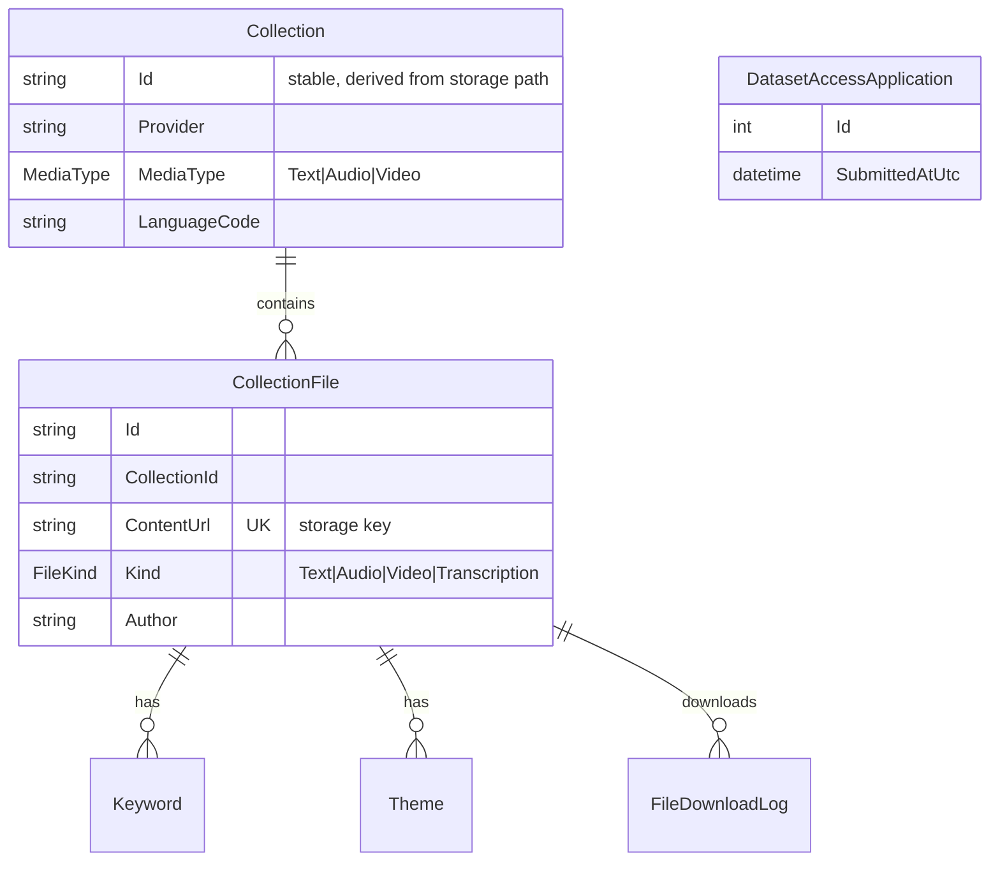
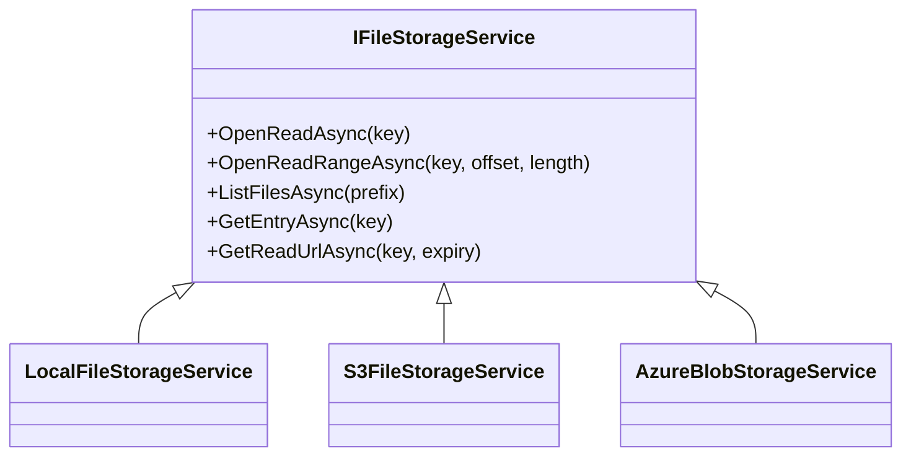
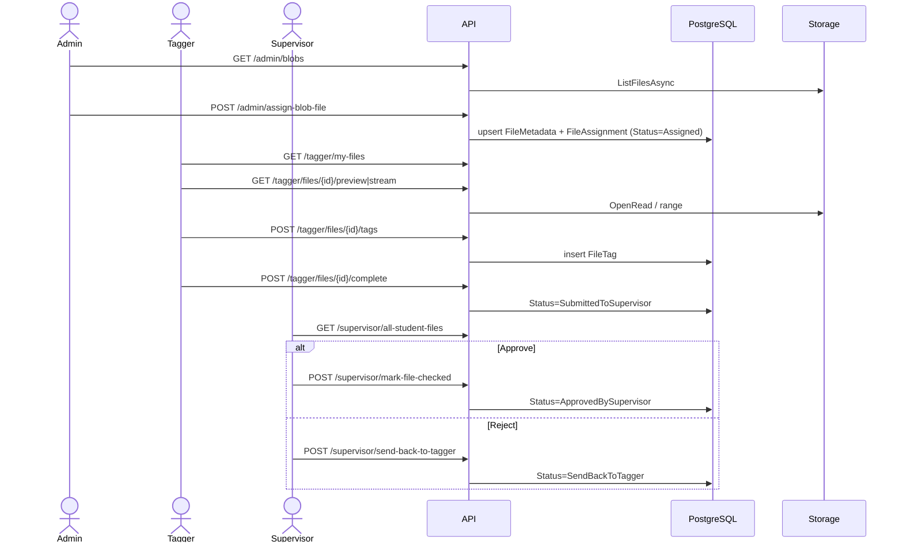
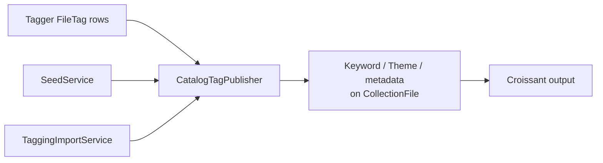
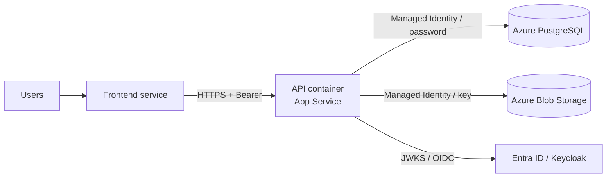

# Chambo Metadata Tagger Backend — Architecture

This document describes the architecture of the **Metadata Tagging API** (`MetadataTagging.csproj`), an ASP.NET Core 8 Web API that combines two products in one deployable:

1. **Tagging workflow** — Admins assign files to Taggers (students), Taggers add metadata tags, Supervisors review and approve.
2. **Catalog API** (ported from the "LRLL" project) — a read-oriented catalog of collections (text, audio, video) stored in object storage, exposed as JSON and as [Croissant 1.0](https://mlcommons.org/croissant/) JSON-LD, enriched with the tags produced by the tagging workflow.

Both share **one PostgreSQL database**, **one object-storage bucket/container**, and **one authentication/authorization model**.

---

## Table of contents

1. [Technology stack](#1-technology-stack)
2. [High-level architecture](#2-high-level-architecture)
3. [Repository layout](#3-repository-layout)
4. [Application startup (Program.cs)](#4-application-startup-programcs)
5. [Configuration & options](#5-configuration--options)
6. [Authentication](#6-authentication)
7. [Authorization](#7-authorization)
8. [HTTP API surface](#8-http-api-surface)
9. [Domain model & database](#9-domain-model--database)
10. [Service layer](#10-service-layer)
11. [File storage abstraction](#11-file-storage-abstraction)
12. [Key workflows](#12-key-workflows)
13. [Catalog subsystem](#13-catalog-subsystem)
14. [Data migration & operations](#14-data-migration--operations)
15. [Deployment](#15-deployment)
16. [Testing](#16-testing)
17. [Cross-cutting concerns](#17-cross-cutting-concerns)
18. [Extension points](#18-extension-points)

---

## 1. Technology stack

| Concern | Technology |
|---|---|
| Runtime / framework | .NET 8, ASP.NET Core Web API (controllers) |
| Database | PostgreSQL via Npgsql + EF Core 8 (code-first migrations) |
| DB auth | Username/password, or Azure Managed Identity (Entra token as password, refreshed every 55 min) |
| Authentication | Local JWT (HS256), Microsoft Entra ID (`Microsoft.Identity.Web`), or Keycloak (OIDC JWT bearer) — exactly one active at a time |
| Password hashing | BCrypt.Net-Next |
| Object storage | Local disk, S3-compatible (AWSSDK.S3), or Azure Blob Storage (Azure.Storage.Blobs + Azure.Identity) |
| Document parsing | PdfPig (PDF text extraction) |
| API docs | Swashbuckle (Swagger UI, Development only) + custom Croissant example filter |
| Tests | xUnit project `MetadataTagging.Tests` |
| Packaging | Docker (`Dockerfile`, `Dockerfile.dev`, `Dockerfile.wbg`) |

---

## 2. High-level architecture



The service is a classic layered monolith:

```
Controllers  →  Services (business logic)  →  EF Core DbContext / IFileStorageService
   (HTTP)         (scoped DI)                     (PostgreSQL)      (blob/file store)
```

The frontend is deliberately **not** served by this app (static-file hosting is commented out in `Program.cs`); it is deployed as a separate service and reaches the API via CORS.

---

## 3. Repository layout

```
ChamboMetadataTaggerBackend/
├── Program.cs                  # Composition root: DI, auth, Swagger, CORS, startup tasks
├── Controllers/                # HTTP endpoints (one controller per audience/feature)
├── Services/                   # Business logic, storage providers, Croissant, import/seed
├── Models/                     # EF Core entities, enums, settings POCOs
├── DTOs/                       # Request/response contracts
├── Data/
│   ├── ApplicationDbContext.cs # EF model configuration & indexes
│   ├── DatabaseReset.cs        # Drop-all-tables helper (ResetOnStartup)
│   └── Migrations/             # EF Core migrations + model snapshot
├── Options/                    # Strongly-typed configuration classes
├── Swagger/                    # CroissantExampleFilter (OpenAPI examples)
├── MetadataTagging.Tests/      # xUnit tests
├── Dockerfile / .dev / .wbg    # Container builds
├── .env.example                # Environment variable template
├── CONFIGURATION.md            # Configuration reference
└── README.md                   # Feature overview and workflows
```

### Controllers

| Controller | Route | Audience |
|---|---|---|
| `AuthController` | `api/auth` | Anyone (login) / authenticated (`me`) |
| `AdminController` | `api/admin` | Role `Admin` |
| `SupervisorController` | `api/supervisor` | Role `Supervisor` |
| `TaggerController` | `api/tagger` | Role `Tagger` |
| `CatalogController` | `api/catalog/collections` | Public catalog browse |
| `CollectionsController` | `api/collections` | Policy `Read` |
| `FilesController` | `api/files` | Policy `Read` (rate-limited downloads) |
| `ApplicationsController` | `api/applications` | Submit (open) / list (policy `Write`) |
| `SeedController` | `api/seed` | Policy `Write` |
| *(minimal API)* | `GET api/health` | Open readiness probe |

### Services

| Group | Classes |
|---|---|
| Identity & users | `AuthService`, `UserService`, `EntraUserProvisioningService`, `EntraTokenClaimsNormalizer`, `KeycloakTokenClaimsNormalizer`, `EntraGroupRoleResolver` |
| Tagging workflow | `FileService`, `SupervisorService`, `TaggingImportService`, `PgDumpCopyReader` |
| Storage | `IFileStorageService` → `LocalFileStorageService`, `S3FileStorageService`, `AzureBlobStorageService`; helpers `AzureBlobPaths`, `CatalogKey`, `FolderListing`, `StorageStreaming`, `ZipStreamResult` |
| Catalog | `SeedService`, `CatalogService`, `CatalogTagPublisher`, `CollectionQueryService`, `CollectionBundleService`, `SummaryService`, `TextChunkService`, `CroissantBuilder`, `CroissantMetadataParser` |

---

## 4. Application startup (Program.cs)

[Program.cs](./Program.cs) is the composition root. Order of operations:

1. **Configuration** — `appsettings*` + environment variables (`AddEnvironmentVariables()`); `__` maps to `:` in section names.
2. **Options binding** — `Configure<T>` for `Authentication`, `JwtSettings`, `Database`, `Cors`, `EntraId`, `Keycloak`, `DefaultAdmin/Tagger/Supervisor`, `CatalogStorage`, `RateLimit`.
3. **Database** — builds a single `NpgsqlDataSource` (when Managed Identity is on) and registers `ApplicationDbContext`. Reusing the data source avoids EF Core's `ManyServiceProvidersCreatedWarning`.
4. **Service registration** — see [§10](#10-service-layer). Storage provider chosen by `CatalogStorage:Provider` (`local` | `s3` | `azure`).
5. **Authentication** — fail-fast validation, then register *only* the provider selected by `Authentication:Method`.
6. **Authorization** — `Read` and `Write` policies.
7. **Swagger, CORS** — OAuth2 (Auth Code + PKCE) definitions are added for Entra/Keycloak.
8. **Startup tasks** (inside a DI scope, before serving traffic):
   - Optional `DatabaseReset.DropAllTablesAsync` when `Database:ResetOnStartup=true`.
   - `Database.MigrateAsync()` — applies EF migrations.
   - Connectivity check logging.
   - Seed default Admin / Tagger / Supervisor users (BCrypt-hashed) if configured and not already present (matched by e-mail).
   - For Azure storage: log the configured prefix (`LogPrefixAsync`) as a diagnostic.
9. **Pipeline** — Swagger (Development only) → CORS (`AllowAll` policy) → Authentication → Authorization → `MapControllers()` → `/api/health`.

Misconfiguration (unknown auth method, missing JWT secret, invalid role/group mappings, conflicting mappings) throws `InvalidOperationException` at startup rather than failing at request time.

---

## 5. Configuration & options

Strongly-typed option classes live in [Options/](./Options) and [Models/AppSettings.cs](./Models/AppSettings.cs). See [CONFIGURATION.md](./CONFIGURATION.md) and [.env.example](./.env.example) for values.

| Section | Class | Purpose |
|---|---|---|
| `Authentication` | `AuthenticationOptions` | `Method`: `Jwt` \| `EntraId` \| `Keycloak` |
| `JwtSettings` | `JwtOptions` | Local JWT issuer/audience/secret/expiry |
| `Database` | `DatabaseOptions` | Host, port, name, user/password, `UseManagedIdentity`, `ManagedIdentityClientId`, `ResetOnStartup` |
| `EntraId` | `EntraIdOptions` | Tenant, client, audience, `RoleClaimType`, `GroupRoleMappings` |
| `Keycloak` | `KeycloakOptions` | Authority, audience, client id, `RoleMappings`, `RequireHttpsMetadata` |
| `Cors` | `CorsOptions` | `AllowedOrigins` (`*`, list, or empty = deny) |
| `CatalogStorage` | `CatalogStorageOptions` | `Provider`, `FileStorageRoot`, `S3`, `Azure` (connection string or `ServiceUri` + `DefaultAzureCredential`, `ContainerName`, `Prefix`) |
| `RateLimit` | `RateLimitOptions` | Download throttling used by `FilesController` |
| `DefaultAdmin/Tagger/Supervisor` | `Default*Settings` | Bootstrap accounts |

---

## 6. Authentication

Exactly one scheme is registered per deployment, chosen by `Authentication:Method`. Other sections may remain populated without activating their scheme.



### Modes

| Mode | Token source | Role source | User record |
|---|---|---|---|
| **Jwt** | `POST /api/auth/login` (`AuthService` verifies BCrypt hash, issues JWT) | `User.Role` column | Created by admins / bootstrap |
| **EntraId** | Entra ID (Auth Code + PKCE for Swagger) | App Roles claim (`RoleClaimType`) and/or group → role mapping (`EntraGroupRoleResolver`) | JIT-provisioned/synced on first token validation |
| **Keycloak** | Keycloak realm | Client roles mapped via `Keycloak:RoleMappings` | JIT-provisioned/synced |

The claims normalizers translate each provider's claim shape into the same internal shape (`ClaimTypes.Role` etc.), so controllers and policies are provider-agnostic. `User.AuthProvider` (`UserAuthProviders`) records origin; `AuthService` has guards that prevent password-login for externally-managed (Entra) accounts (see `AuthServiceEntraGuardTests`).

### Startup validation

- Jwt: `JwtSettings:SecretKey` required.
- EntraId: `TenantId` + `ClientId` required; each `GroupRoleMappings` entry needs a GUID group id and a recognized role; a group may not map to two roles.
- Keycloak: `Authority` required; each mapping needs a client role name and recognized role; no conflicting mappings.

---

## 7. Authorization

Roles (`UserRoles`): **Admin**, **Supervisor**, **Tagger**.

| Mechanism | Used by | Rule |
|---|---|---|
| `[Authorize(Roles = Admin)]` | `AdminController` | Admins only |
| `[Authorize(Roles = Supervisor)]` | `SupervisorController` | Supervisors only |
| `[Authorize(Roles = Tagger)]` | `TaggerController` | Taggers only |
| Policy `Read` | Collections, Files | Any authenticated user |
| Policy `Write` | Seed, Applications (list) | Admin role |

The catalog's `Read`/`Write` policies were originally gated on Azure AD groups/Keycloak roles in LRLL and were remapped onto Chambo's role model. In addition, taggers/supervisors are scoped to *their own* data in the service layer (e.g. a tagger can only access files assigned to them).

---

## 8. HTTP API surface

### Auth — `api/auth`
`POST login`, `GET me`.

### Admin — `api/admin`
| Area | Endpoints |
|---|---|
| Users | `GET/POST users`, `POST users/bulk`, `GET/PUT/DELETE users/{id}`, `GET taggers` |
| Storage browsing | `GET blobs`, `GET blobs/preview`, `GET blobs/stream`, `POST sync-blobs` |
| Files | `GET files`, `GET files/unassigned`, `POST files`, `GET files/{id}`, `GET files/{id}/preview`, `GET files/{id}/stream`, `PUT files/{id}/audio-metadata` |
| Assignment | `POST assign-file`, `POST assign-blob-file`, `POST assign-multiple-files`, `POST clear-assignments` |
| Supervision | `POST assign-student-to-supervisor`, `POST unassign-student-from-supervisor`, `GET supervisor-assignments` |
| Reporting | `GET tagging-progress`, `GET export/annotations` |
| Operations | `POST import-taggings`, `POST reset-database` |

### Tagger — `api/tagger`
`GET my-files`, `GET files/{id}`, `POST files/{id}/tags`, `POST files/{id}/complete`, `GET files/{id}/preview`, `GET files/{id}/stream`, `PUT files/{id}/audio-metadata`.

### Supervisor — `api/supervisor`
`GET my-students`, `GET students/{id}/files`, `GET all-student-files`, `GET files/{id}/preview`, `GET files/{id}/stream`, `POST mark-file-checked`, `POST send-back-to-tagger`, `PUT files/{id}/tags`.

### Catalog
| Route | Auth | Purpose |
|---|---|---|
| `GET api/catalog/collections`, `/facets`, `/{id}`, `/{id}/files` | Anonymous | Listing, facets, details, files |
| `GET api/collections/query` | `Read` | Filtered collection query (Croissant JSON-LD) |
| `GET api/collections/{id}/bundle` | `Read` | ZIP bundle (media + transcription) |
| `GET api/collections/summary` | Anonymous | Aggregated stats |
| `GET api/collections/health` | Anonymous | Catalog health |
| `GET api/files/{id}`, `/{id}/bundle` | `Read` | File content / paired bundle (rate-limited) |
| `POST api/applications`, `GET api/applications` | open / `Write` | Dataset-access applications (see [catalog-ip-protection-provisioning.md](./catalog-ip-protection-provisioning.md)) |
| `POST api/seed` | `Write` | Re-scan storage and rebuild catalog rows |

### Operational
`GET /api/health` → `{ status, timestamp }` (readiness probe, unauthenticated).

---

## 9. Domain model & database

Schema is managed by **EF Core migrations** (`Data/Migrations`): `InitialBaseline` → `AddSoundTranscriptionPairing` → `UnifiedCollections` → `NormalizeBlobNames`. They run automatically at startup.

### 9.1 Tagging workflow entities



**`FileTaggingStatus` lifecycle**



`FileCategory` (`Text`, `Audio`, `Image`, `Video`, `Document`, `Other`) is derived from content type/extension by `FileCategoryHelper`; the tag schema differs by category (e.g. audio metadata).

### 9.2 Catalog entities



- Collection rows are **derived data**: `POST /api/seed` rebuilds them from storage; IDs are deterministic (from storage path or JSON-LD identifier) so they survive re-seeding.
- `CollectionFile.ContentUrl` is a unique index and equals the storage key; sound files link to their transcription (`AddSoundTranscriptionPairing`).
- Indexes: media type, provider, language, file kind, author, keyword/theme value and file id; plus tagging indexes (status, blob name, tag key, user/file pairs).

### 9.3 The link between both halves

`FileMetadata.BlobName` (tagging) and `CollectionFile.ContentUrl` (catalog) are the **same storage key** (`Provider/CollectionFolder/...`). The `NormalizeBlobNames` migration and `CatalogKey` ensure keys are canonical. This shared key lets approved tags flow into the catalog (see §13.3).

---

## 10. Service layer

All services are registered in `Program.cs`.

| Lifetime | Registrations |
|---|---|
| Scoped | `IAuthService`, `IUserService`, `IEntraUserProvisioningService`, `IFileService`, `ISupervisorService`, `TaggingImportService`, `CatalogTagPublisher`, `SeedService`, `CatalogService`, `CollectionQueryService`, `CollectionBundleService`, `SummaryService` |
| Singleton | `IFileStorageService` (provider-specific), `CroissantMetadataParser`, `CroissantBuilder`, `TextChunkService` |

Responsibilities:

- **AuthService / UserService** — credential verification, JWT issuance, user CRUD and bulk creation.
- **EntraUserProvisioningService** — creates/updates local users from validated external tokens, matching by e-mail so pre-created or imported users are "taken over" on first sign-in.
- **FileService** — blob listing/sync, file registration, assignment, tag CRUD, completion, progress reporting, secure preview/stream; enforces per-user access.
- **SupervisorService** — student/supervisor links, review, approve/send-back, tag edits.
- **TaggingImportService** — imports legacy data from a plain-SQL `pg_dump` (see §14).
- **SeedService** — scans storage and synchronises catalog tables.
- **CatalogService / CollectionQueryService** — browse, facets, filtered queries.
- **CollectionBundleService** — ZIP streaming of media + transcription.
- **CroissantBuilder / CroissantMetadataParser** — produce / consume Croissant JSON-LD.
- **TextChunkService** — extracts paragraphs from TXT/MD/PDF (PdfPig).
- **SummaryService** — aggregates across collections, files, keywords, themes.
- **CatalogTagPublisher** — projects tagger `FileTag`s onto catalog files.

---

## 11. File storage abstraction



- A **single bucket/container** is the application's only file store, laid out `Provider/CollectionFolder/<files>`. Taggers, the seeder and the catalog API all use it.
- `OpenReadRangeAsync` enables HTTP range requests for audio/video streaming; `StorageStreaming` and `ZipStreamResult` stream content without buffering whole files.
- `GetReadUrlAsync` returns provider-native time-limited URLs where supported (e.g. SAS for Azure), else `null`, in which case the API proxies the bytes.
- Azure: auth via connection string or `ServiceUri` + `DefaultAzureCredential`; an optional `Prefix` (e.g. `markdown/CATALOGPROD`) is stripped so keys stay relative (`AzureBlobPaths`).
- `FolderListing` builds virtual folder views from flat key listings.

---

## 12. Key workflows

### 12.1 Tagging lifecycle



### 12.2 Login (Jwt mode)

`POST /api/auth/login` → `AuthService` loads user (active only), verifies BCrypt hash → issues JWT with role claim → client sends `Authorization: Bearer`.

### 12.3 External login (Entra / Keycloak)

Client obtains token from the IdP → API validates signature/audience → `OnTokenValidated` runs the normalizer → role resolved from claims/group mappings → local user JIT-provisioned or synchronised → request continues with normalized claims.

---

## 13. Catalog subsystem

### 13.1 Seeding

`POST /api/seed` (Admin) runs `SeedService`:

- Walks `Provider/CollectionFolder` entries in storage.
- A folder with audio/video becomes an audio/video collection (video if any video present); a folder without becomes a **text** collection whose PDF/TXT/MD files are scanned.
- Reads Croissant JSON-LD sidecars via `CroissantMetadataParser` when present.
- Performs a **full sync**: inserts new, updates changed, deletes rows whose content disappeared. IDs are stable across runs.
- Enriches each file with tags from its ready tagger entry via `CatalogTagPublisher`.

### 13.2 Serving

- **Browse/query**: `CatalogController`, `CollectionsController` → `CatalogService`/`CollectionQueryService` with facets and pagination.
- **Croissant**: `CroissantBuilder` emits one `sc:Dataset` per collection in `@graph`; text carries statistics and tags; audio/video carry EBU Core technical metadata, paired transcription, keywords/themes; collections carry DQV quality measurements.
- **Text**: never bundled; served as shuffled paragraphs (`TextChunkService`) to avoid whole-document redistribution.
- **Audio/Video**: `CollectionBundleService` streams a ZIP of media + transcription.
- **Download auditing & throttling**: `FileDownloadLog` rows; `RateLimitOptions` consumed by `FilesController`.

### 13.3 Tag publication



Both seeding and legacy import call the publisher, so tags appear in the catalog regardless of which step runs first.

### 13.4 Dataset access applications

`ApplicationsController` stores `DatasetAccessApplication` submissions (indexed by `SubmittedAtUtc`); only `Write` (Admin) can list them.

---

## 14. Data migration & operations

- **Migrations on boot**: `MigrateAsync()` always runs. For an already-provisioned DB, see the notes in the `InitialBaseline` migration.
- **`Database:ResetOnStartup`**: drops every table, then migrates. Destructive; intended for dev/test only. A warning is logged on every start.
- **`POST /api/admin/reset-database`**: admin-triggered reset.
- **`POST /api/admin/import-taggings`**: `TaggingImportService` + `PgDumpCopyReader` parse a plain-SQL `pg_dump` of the pre-migration database. Old users are not imported — tags/assignments are attributed to a designated tagger and approver (created if missing so their first Entra sign-in takes them over). Existing files/assignments/tags are replaced; users and supervisor links are kept; blob names are normalized to catalog keys and tags published to seeded files.
- **Bootstrap accounts**: `DefaultAdmin/Tagger/Supervisor` created at startup only if absent.
- **Health**: `GET /api/health` for liveness/readiness.

---

## 15. Deployment

- Container images: `Dockerfile` (production; .NET SDK 8 build → ASP.NET 8 runtime, exposes port 80, entrypoint `dotnet MetadataTagging.dll`), `Dockerfile.dev`, and `Dockerfile.wbg` (World Bank internal registry variant).
- Designed for Azure App Service / containers: HTTPS redirection is intentionally off (TLS terminated upstream); configuration comes from environment variables (`Section__Key`).
- Azure-native identity: Managed Identity for PostgreSQL (token password via `UsePeriodicPasswordProvider`) and for Blob Storage (`DefaultAzureCredential`).
- Swagger UI is enabled only in `Development`.
- The frontend is a separate service; set `Cors:AllowedOrigins` accordingly.



---

## 16. Testing

`MetadataTagging.Tests` (xUnit) covers the high-risk logic:

| Area | Test files |
|---|---|
| Auth/identity | `AuthServiceEntraGuardTests`, `EntraGroupRoleResolverTests`, `EntraTokenClaimsNormalizerTests`, `EntraUserProvisioningServiceTests`, `KeycloakTokenClaimsNormalizerTests` |
| Storage/paths | `AzureBlobPathsTests`, `FolderListingTests` |
| Tagging | `FileServiceAssignedCountTests`, `TaggingImportServiceTests` |
| Catalog | `CatalogSeedingTests`, `TextServingTests` |

Run with `dotnet test MetadataTagging.sln`.

---

## 17. Cross-cutting concerns

| Concern | Approach |
|---|---|
| Error contracts | `ApiResponse` DTO wrapper plus specific response DTOs in `DTOs/` |
| Pagination | `PaginationDtos`, `CollectionQueryParams` |
| Logging | `ILogger` with structured messages; startup diagnostics for DB and storage |
| Security | BCrypt hashes; fail-fast auth config validation; role/policy gating; per-user data scoping; CORS allow-list; time-limited storage URLs; download rate limiting; Swagger off in production |
| Performance | Streaming (range reads, ZIP streaming), indexed queries, singleton storage clients, single shared `NpgsqlDataSource` |
| Observability | `/api/health`, startup connection checks |
| API documentation | XML doc comments included in Swagger; `CroissantExampleFilter` injects JSON-LD examples |

---

## 18. Extension points

- **New storage provider** — implement `IFileStorageService`, add a branch in the provider selection in `Program.cs`.
- **New identity provider** — add an `Authentication:Method` value, a claims normalizer that emits `ClaimTypes.Role`, and a startup validation block.
- **New role/policy** — extend `UserRoles`, add to `recognizedRoles`, register a policy in `AddAuthorization`.
- **New file category / tag schema** — extend `FileCategory`/`FileCategoryHelper` and the tag handling in `FileService`.
- **New catalog metadata** — extend `CroissantBuilder` and the seeding/parsing path, add a migration.
- **Schema change** — `dotnet ef migrations add <Name>`; applied automatically on next start.
