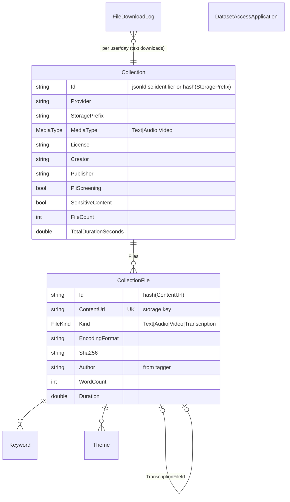
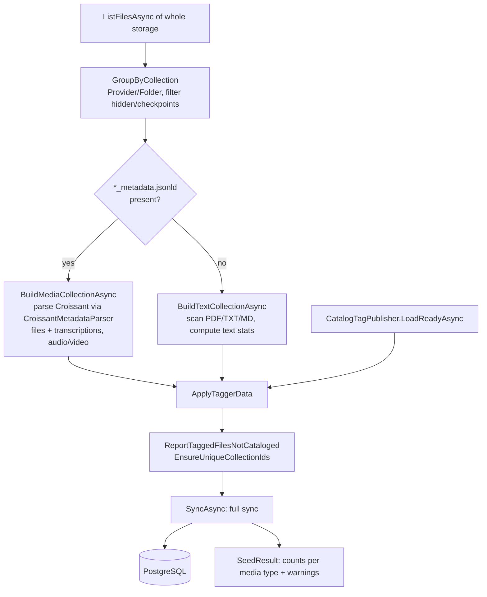
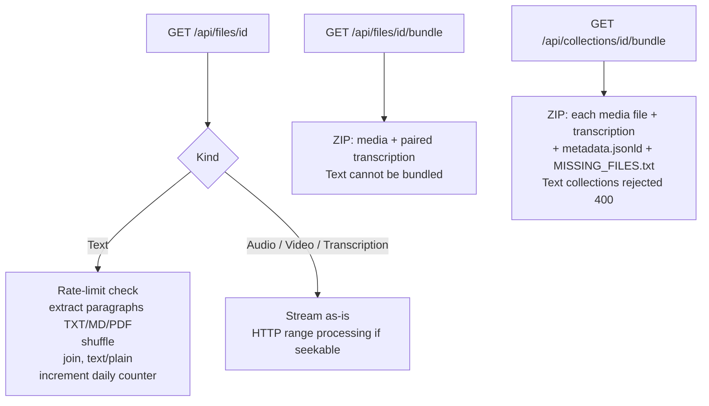
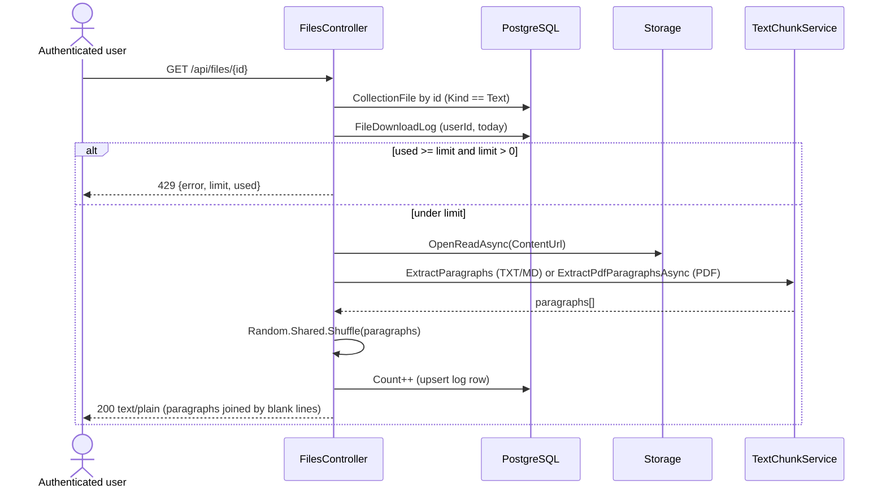
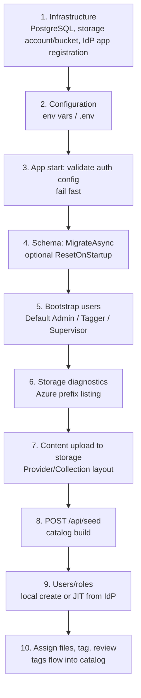
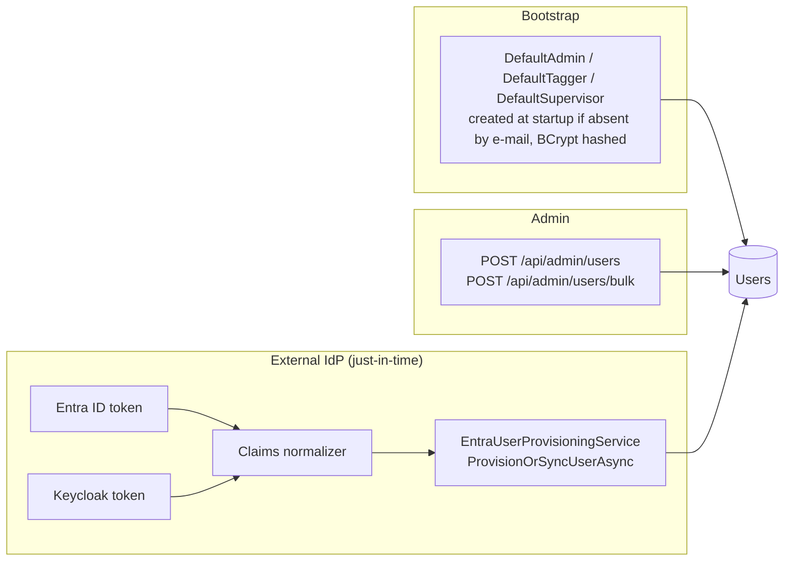
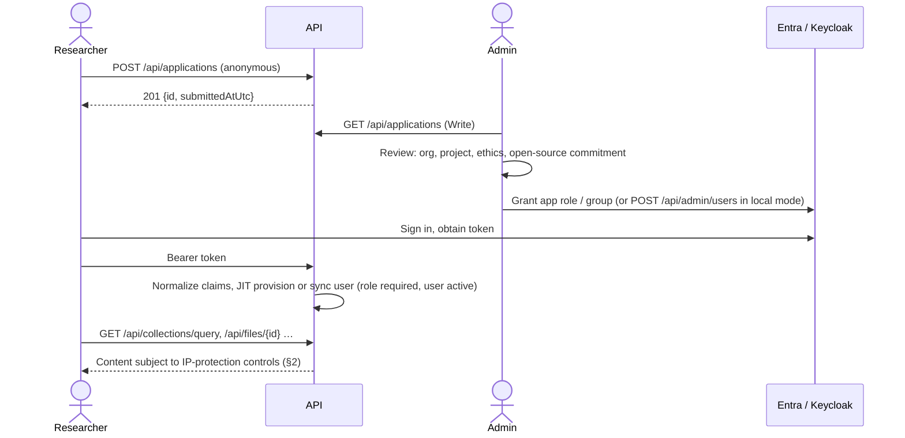
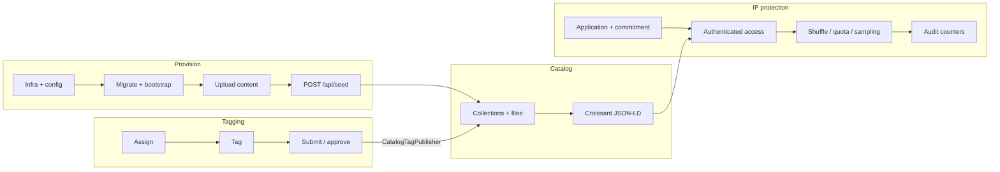

# Catalog, IP Protection & Provisioning

A focused companion to [architecture.md](./architecture.md). It covers three topics:

1. **Catalog** — how collections are discovered, modeled, enriched, queried and published.
2. **IP protection** — the controls that limit how much of the underlying content (text, audio, video) a consumer can extract.
3. **Provisioning** — how storage, schema, users, roles and dataset-access requests are brought into existence and kept in sync.

---

## Table of contents

1. [Catalog](#1-catalog)
2. [IP protection](#2-ip-protection)
3. [Provisioning](#3-provisioning)
4. [End-to-end view](#4-end-to-end-view)

---

## 1. Catalog

### 1.1 Purpose

The catalog turns a bucket/container of raw collection folders into a queryable, searchable, machine-readable dataset catalog (Croissant 1.0 JSON-LD), enriched with human-created tags from the tagging workflow. Collections hold **text** (PDF/TXT/MD), **audio** and **video** (with paired transcriptions).

### 1.2 Storage layout (source of truth)

Object storage is the source of truth; the database catalog tables are a **derived index** that can be rebuilt at any time.

```
<bucket or container>/[Azure:Prefix/]
└── <Provider>/                     e.g. "Radio Maria"
    └── <CollectionFolder>/         e.g. "KUCHEZA"          → one Collection
        ├── *_metadata.jsonld       (Croissant sidecar; marks an audio/video collection)
        ├── audio / video files     (.mp3 .wav .flac .mp4 .mkv …)
        ├── transcriptions          (may live in subfolders)
        └── *.pdf / *.txt / *.md    (text collections, no sidecar)
```

Rules enforced by [SeedService](./Services/SeedService.cs) and [CatalogKey](./Services/CatalogKey.cs):

- Keys are normalized (forward slashes, no leading `./` or `/`) so tagger `BlobName` and catalog `ContentUrl` compare directly.
- Content must be at least `Provider/Collection/file` deep; shallower files are ignored with a warning.
- Hidden files/folders (any segment starting with `.`) and folders containing `checkpoints` are never cataloged.
- A `*_metadata.jsonld` file (shallowest first) designates an **audio/video** collection; otherwise the folder is a **text** collection and its `.pdf/.txt/.md` files are scanned.

### 1.3 Data model



Notable fields:

- **Compliance flags on `Collection`**: `License`, `PiiScreening`, `SensitiveContent`, `Creator`, `Publisher`, `SourceOrganization` — emitted in the Croissant output (`sc:license`, `ddpv:piiScreening`, `ddpv:sensitiveContent`; the PII/sensitivity flags are emitted for media collections).
- **Integrity**: `CollectionFile.Sha256` is surfaced as `cr:sha256`.
- **Technical metadata** (audio/video): duration, sample rate, channels, bitrate, integrated loudness, SNR (EBU Core).
- **Pairing**: audio/video `TranscriptionFileId` links a media file to its transcription.
- Indexes support the query paths (media type, provider, language, kind, author, keyword/theme value). `ContentUrl` is unique.

### 1.4 Seeding pipeline

`POST /api/seed` (policy `Write` = Admin) runs `SeedService.SeedAsync`:



Properties:

- **Idempotent full sync** — new rows inserted, changed rows updated, rows whose content vanished from storage deleted.
- **Stable IDs** — collection id = jsonld identifier or a hash of the storage prefix; file id = hash of the content URL. Clients can cache/bookmark IDs across re-seeds.
- **Self-reporting** — skipped/inconsistent content (files outside layout, duplicate ids, tagged-but-uncataloged files) is returned in `warnings` instead of failing the run.
- **Media type inference** — a collection is Video if any listed file is video, else Audio; text otherwise.

### 1.5 Tag publication (tagging → catalog)

[CatalogTagPublisher](./Services/CatalogTagPublisher.cs) is the bridge between the two products:

- Reads `FileMetadata` + `FileTag` rows keyed by `BlobName` (== `CollectionFile.ContentUrl`).
- Only files in a **ready status** contribute: `SubmittedToSupervisor` or `ApprovedBySupervisor`. All other files get storage-derived values only (no tags, file name as title).
- Extracts `Theme` (top-level only: `"Health > Clinics | Education"` → `Health`, `Education`), `Keywords`, `Author`, `Title`.
- Writes keywords/themes/author on each `CollectionFile` (and the title as the name of text files); caps collection-level tags (`MaxCollectionTags = 20`) and chunks lookups (500 keys per query).
- Called from three places: the seed (fresh rows), the tagging workflow (live update when tags/status change), and `TaggingImportService` (legacy import).

### 1.6 Read APIs

| Endpoint | Auth | Purpose |
|---|---|---|
| `GET /api/catalog/collections` | **Anonymous** | Paged collection list with filters |
| `GET /api/catalog/collections/facets` | **Anonymous** | Facet counts (media type, provider, language, …) |
| `GET /api/catalog/collections/{id}` | **Anonymous** | Collection details |
| `GET /api/catalog/collections/{id}/files` | **Anonymous** | Paged file listing |
| `GET /api/collections/query` | `Read` | Croissant JSON-LD sample of files (see §1.7) |
| `GET /api/collections/{id}/bundle` | `Read` | ZIP of an audio/video collection |
| `GET /api/collections/summary` | **Anonymous** | Aggregate stats per media type |
| `GET /api/collections/health` | **Anonymous** | API status + cataloged file count |
| `GET /api/files/{id}` | `Read` | File content (rules differ by kind) |
| `GET /api/files/{id}/bundle` | `Read` | ZIP of media + transcription |
| `POST /api/applications` | **Anonymous** | Submit a dataset-access application |
| `GET /api/applications` | `Write` (Admin) | Review applications |
| `POST /api/seed` | `Write` (Admin) | Re-scan storage / rebuild catalog |

**Split of visibility:** *discovery* (metadata, facets, summaries) is public; *content* (query results, files, bundles) requires authentication.

### 1.7 Croissant output

[CroissantBuilder](./Services/CroissantBuilder.cs) emits one `sc:Dataset` node per collection inside `@graph`:

- **Collection**: license, creator/publisher, temporal coverage, language, `ddpv:piiScreening`, `ddpv:sensitiveContent`, and DQV quality measurements.
- **Text files**: word/char/token/page counts, `cr:sha256`, tagger keywords/themes/author.
- **Audio/video files**: EBU Core technical metadata, `cr:sha256`, the paired transcription, tagger keywords/themes.

`CollectionQueryService.QueryAsync` semantics:

- Filters (all optional, combinable): media type, collection id, provider, language, keyword/theme, etc.
- **Sampling, not paging** — filtered queries return a random sample up to `limit` (default **30**, max **100** when supplied); an unfiltered query returns a random **80 %** of all files.
- Only primary files (text/audio/video) are sampled; each audio/video entry carries its transcription.
- Randomization (`OrderBy(_ => Guid.NewGuid())`) is applied to the *metadata selection*, not to file content.

### 1.8 Content delivery by kind



Error mapping: unknown id / missing blob / invalid path → `404`; unreadable or encrypted PDF → `422`; daily limit reached → `429`.

---

## 2. IP protection

The service hosts content that its providers (e.g. broadcasters, publishers) license for **research and model-building under conditions**. The architecture applies layered, *proportionate* controls: access gating, content-shape controls, quota, auditability, and contractual commitment. It is a **deterrence and friction** model, not DRM.

### 2.1 Control matrix

| # | Layer | Control | Where | Protects against |
|---|---|---|---|---|
| 1 | Contractual | Dataset-access application with ethical-handling statement and mandatory **open-source commitment** | `ApplicationsController`, `DatasetAccessApplication` | Anonymous/unvetted use; closed-source reuse of derived insights/models |
| 2 | Identity | All content endpoints require authentication (`Read` policy); one auth provider enforced per deployment | `Program.cs`, controllers | Anonymous scraping |
| 3 | Separation of duties | Seeding, application review and write operations are Admin-only (`Write`) | `SeedController`, `ApplicationsController.List` | Catalog tampering, applicant data exposure |
| 4 | Content shaping — **text** | Text is *never* delivered as an intact document: paragraphs are extracted and **returned in random order**, joined into one plain-text body | `FilesController.DownloadTextAsync`, `TextChunkService` | Reconstruction/redistribution of the original work |
| 5 | Content shaping — **text bundling** | Text files cannot be bundled into ZIPs | `CollectionBundleService`, `FilesController` | Bulk exfiltration of text |
| 6 | Quota | Per-user **daily text download limit** (`RateLimit:DailyFileDownloadLimit`, UTC day; `0` = unlimited) | `FilesController`, `FileDownloadLog` | High-volume harvesting |
| 7 | Sampling | Query API returns a random **sample** (default 30, max 100; unfiltered 80 %) rather than deterministic full listings | `CollectionQueryService`, `CollectionQueryParams` | Systematic enumeration through the query endpoint |
| 8 | Media pairing | Audio/video is delivered with its transcription as a unit (ZIP), preserving provenance/attribution | `CollectionBundleService` | Orphaned content without context |
| 9 | Provenance metadata | License, creator, publisher, source organization, `sha256`, PII/sensitivity flags travel with the data in Croissant | `CroissantBuilder` | Misattribution; hidden sensitivity |
| 10 | Storage security | No public blob URLs by default; API streams through the app or issues time-limited read URLs; keys validated (`UnauthorizedAccessException` → 404) | `IFileStorageService`, `LocalFileStorageService`, controllers | Direct-link leakage, path traversal |
| 11 | Network | CORS allow-list; Swagger only in Development | `Program.cs` | Cross-origin abuse; exposed API explorer in prod |
| 12 | Audit | `FileDownloadLog` (user, UTC date, count); application timestamps | `Data`, `FilesController` | Non-repudiation, abuse investigation |

### 2.2 Text: shuffled-paragraph delivery



Details:

- Paragraph boundary = blank line (`\n\n` / `\r\n\r\n`); PDFs use PdfPig word extraction + Docstrum layout blocks per page.
- Shuffling preserves content usefulness for NLP/LLM training (paragraph-level tokens) while destroying narrative order, so the output is not a drop-in substitute for the original publication.
- The counter is incremented **only after successful** extraction, so failed reads (e.g. `422`) do not consume quota.
- Identity key for quota: `ClaimTypes.NameIdentifier` → `sub` → `"anonymous"`. Under all three auth modes the normalizers set `NameIdentifier` to the **local user id**, so quotas are per local user regardless of IdP.

### 2.3 Audio/video

Audio/video is streamed as-is (with range support) or bundled with its transcription. There is no shuffling or quota for media in the current implementation; the controls are authentication, the research-use agreement, bundling semantics, and storage-level protections (see §2.8).

ZIP bundling details: already-compressed media uses `CompressionLevel.NoCompression`, transcriptions use `Optimal`; missing members are skipped and listed in `MISSING_FILES.txt` so a partial archive is never silently incomplete.

### 2.4 Dataset-access application (vetting & commitment)

`POST /api/applications` (anonymous, so prospective researchers can apply before having an account) captures:

`FirstName`, `LastName`, `Organization`, `OrganizationEmail`, `JobTitle`, `ProjectDescription`, `EthicalDataHandling`, and `OpenSourceCommitment`.

Server-side rules:

- Every text field is required (trimmed, rejected if blank).
- `OpenSourceCommitment` **must be true** — "commit to open-source publication of derived insights and/or models" — otherwise `400` with a validation problem.
- The stored `OpenSourceCommitment` is forced to `true`; `SubmittedAtUtc` is server-assigned.
- The response returns only `Id` and `SubmittedAtUtc` (no echo of personal data).
- Admins (`Write` policy) list applications newest-first with paging; applicant PII is therefore Admin-only.

Approval is an out-of-band, human step: the application records intent and creates an audit trail; granting access means provisioning the user (see §3.3).

### 2.5 Authentication & authorization as an IP control

- Content endpoints use policy `Read` (any authenticated, active, locally-provisioned user).
- External tokens are rejected unless a **local active user** can be provisioned with a recognized role (see §3.3), so a valid IdP token alone is not enough: deactivating the local user (`IsActive = false`) revokes access even if the IdP still issues tokens.
- `Write` is Admin only, covering `POST /api/seed` (which can expose newly added storage content to the catalog) and application review.

### 2.6 Storage-level protection

- Keys passed to the storage layer originate from DB records (`ContentUrl`), never directly from user input on content endpoints; invalid paths raise `UnauthorizedAccessException` and are returned as `404` (no information leak about what exists).
- Azure/S3 credentials are server-side only; Azure supports Managed Identity (`DefaultAzureCredential`) so no account key is needed in production.
- `IFileStorageService.GetReadUrlAsync(key, expiry)` provides short-lived provider URLs where needed; default behavior is to proxy bytes through the API so every access is authenticated and auditable.

### 2.7 Sensitive content & PII declarations

`PiiScreening` and `SensitiveContent` are captured per collection (from the Croissant sidecar) and exposed to consumers in the Croissant metadata (`ddpv:*`). They are **declarations** that let consumers make informed handling decisions; the API does not itself detect or redact PII.

---

## 3. Provisioning

"Provisioning" here means everything that must exist, and be kept consistent, for the platform to work: infrastructure dependencies, schema, bootstrap accounts, user lifecycle, role mapping, and catalog data.

### 3.1 Provisioning order



### 3.2 Infrastructure & configuration

| Resource | Provisioning inputs |
|---|---|
| PostgreSQL | `Database:Host/Port/Name/Username` + password, **or** `Database:UseManagedIdentity=true` (+ optional `ManagedIdentityClientId`): the app obtains an Entra token for `https://ossrdbms-aad.database.windows.net/.default` and rotates it every 55 min via `UsePeriodicPasswordProvider`. SSL is required in this mode. |
| Object storage | `CatalogStorage:Provider` = `local` (`FileStorageRoot`), `s3` (`ServiceUrl`, `BucketName`, keys, `ForcePathStyle`, `Region`), or `azure` (`ConnectionString` **or** `ServiceUri` + `DefaultAzureCredential`, `ContainerName`, `Prefix`). One container/bucket for tagging **and** catalog. |
| Identity | `Authentication:Method` plus the matching section: `JwtSettings`, `EntraId` (tenant, client, audience, role claim, group mappings), or `Keycloak` (authority, audience, client id, role mappings). |
| Web | `Cors:AllowedOrigins`; `RateLimit:DailyFileDownloadLimit`. |

Environment variables use `Section__Key` (e.g. `CatalogStorage__Azure__ContainerName`). See [CONFIGURATION.md](./CONFIGURATION.md) and [.env.example](./.env.example).

Misconfiguration is rejected **at startup** (unknown auth method, missing JWT secret, missing Entra tenant/client or Keycloak authority, invalid or conflicting group/role mappings), so a bad deployment fails the readiness probe instead of silently running insecurely.

### 3.3 Identity & user provisioning

Three ways a `User` row comes into existence:



**a) Bootstrap accounts** — if `DefaultAdmin|DefaultTagger|DefaultSupervisor` has e-mail, username and password set, the account is created on startup unless a user with that e-mail exists. (Treat these passwords as one-time secrets; rotate/remove them after first login. In Entra/Keycloak deployments they are optional.)

**b) Admin-managed (local) accounts** — `UserService.CreateUserAsync` rejects duplicate username/e-mail, BCrypt-hashes the password and stores the role. `BulkCreateUsersAsync` processes a list and returns a per-row result, so one bad row does not abort the batch.

**c) JIT provisioning from Entra ID / Keycloak** — [EntraUserProvisioningService](./Services/EntraUserProvisioningService.cs):

1. The token is validated (signature, issuer, audience, lifetime) by the JWT bearer handler.
2. `OnTokenValidated` runs the provider-specific normalizer:
   - **Entra**: roles from the `roles` claim (App Roles) and/or group object IDs mapped via `EntraId:GroupRoleMappings` ([EntraGroupRoleResolver](./Services/EntraGroupRoleResolver.cs)).
   - **Keycloak**: client roles under `resource_access[ClientId]` mapped via `Keycloak:RoleMappings`; e-mail from `preferred_username`/`email`.
3. `ProvisionOrSyncUserAsync(email, displayName, roles, authProvider)`:
   - No e-mail → rejected.
   - **No recognized role → rejected** (`null`): an authenticated IdP user without an app role gets no access.
   - Multiple roles → **most privileged wins** (Admin > Supervisor > Tagger).
   - Existing user (case-insensitive e-mail match) → updated: role, auth provider, display name (with unique-username resolution `Name`, `Name (2)`, …), `LastLoginAt`. **Inactive users are rejected.**
   - New user → created with `PasswordHash = null`, `IsActive = true`.
   - Concurrent first logins are handled: a unique-index collision is caught, the tracked entity detached and the existing row synced.
4. The normalizer replaces the principal's identity with a **local application identity** (`NameIdentifier` = local int id, `Name`, `Email`, `Role`). Everything downstream (controllers, policies, quota keys) is IdP-agnostic.

Key consequences:

- **Roles are owned by the IdP** in external modes: the role is overwritten on every login, so revoking a role/group in Entra/Keycloak takes effect at next token validation.
- **Pre-created or imported users are "taken over"** on first SSO login via e-mail match (this is how legacy tagging data is re-attached — see §3.5).
- Entra-only accounts have no password hash and cannot use the local login flow.

### 3.4 Tagging-workflow provisioning

Admin endpoints prepare the work to be done:

| Step | Endpoint |
|---|---|
| Browse storage | `GET /api/admin/blobs`, `blobs/preview`, `blobs/stream` |
| Register files | `POST /api/admin/sync-blobs`, `POST /api/admin/files` |
| Link people | `POST /api/admin/assign-student-to-supervisor`, `unassign-student-from-supervisor`, `GET supervisor-assignments` |
| Assign work | `POST /api/admin/assign-file`, `assign-blob-file`, `assign-multiple-files` (blob files auto-import to `FileMetadata`) |
| Undo | `POST /api/admin/clear-assignments` |

### 3.5 Schema, data and catalog provisioning

- **Schema** — EF Core migrations run on every start (`MigrateAsync`). `Database:ResetOnStartup=true` drops all tables first (dev/test only; a warning is logged every start). For an already-provisioned production database, apply the `InitialBaseline` migration notes before first run.
- **Catalog** — upload content to storage, then call `POST /api/seed`. Re-run after any change in storage; the sync adds, updates and removes rows accordingly. Review the returned `warnings`.
- **Legacy tagging data** — `POST /api/admin/import-taggings` ([TaggingImportService](./Services/TaggingImportService.cs), [PgDumpCopyReader](./Services/PgDumpCopyReader.cs)) ingests a plain-SQL `pg_dump` from the pre-migration database:
  - Old users are **not** imported; tags/assignments are attributed to a designated tagger and approver, created if missing so their first SSO sign-in (matched by e-mail) takes them over.
  - Files, assignments, tags are replaced; users and supervisor links are kept.
  - Blob names are normalized to catalog keys, and tags are published to already-seeded catalog files.
- **Reset** — `POST /api/admin/reset-database` for an admin-initiated wipe.

### 3.6 Data-access provisioning (end to end)



Revocation: deactivate the local user (`IsActive = false`) and/or remove the IdP role/group. Both block access on the next request (inactive users are rejected during provisioning/login).

### 3.7 Operational provisioning checklist

- [ ] Database reachable; Managed Identity granted DB access if used.
- [ ] Storage container exists; identity has *read* (catalog) and *list* permissions; correct `Azure:Prefix`.
- [ ] `Authentication:Method` and its section populated; role/group mappings valid and non-conflicting.
- [ ] `Cors:AllowedOrigins` set to the frontend origin(s); not `*` in production.
- [ ] `RateLimit:DailyFileDownloadLimit` set (> 0) in production.
- [ ] `Database:ResetOnStartup=false`.
- [ ] Bootstrap passwords rotated/removed after first login.
- [ ] Content uploaded in `Provider/Collection/...` layout with `*_metadata.jsonld` for audio/video; `POST /api/seed` run and `warnings` reviewed.
- [ ] `GET /api/health` returns `healthy`.

---

## 4. End-to-end view



Summary: **storage is the source of truth**, **the seed derives the catalog**, **tagging enriches it**, and **access to content is mediated** by authenticated identity, a vetted research commitment, content-shape controls (shuffled text, sampled queries, paired media) and quotas.
